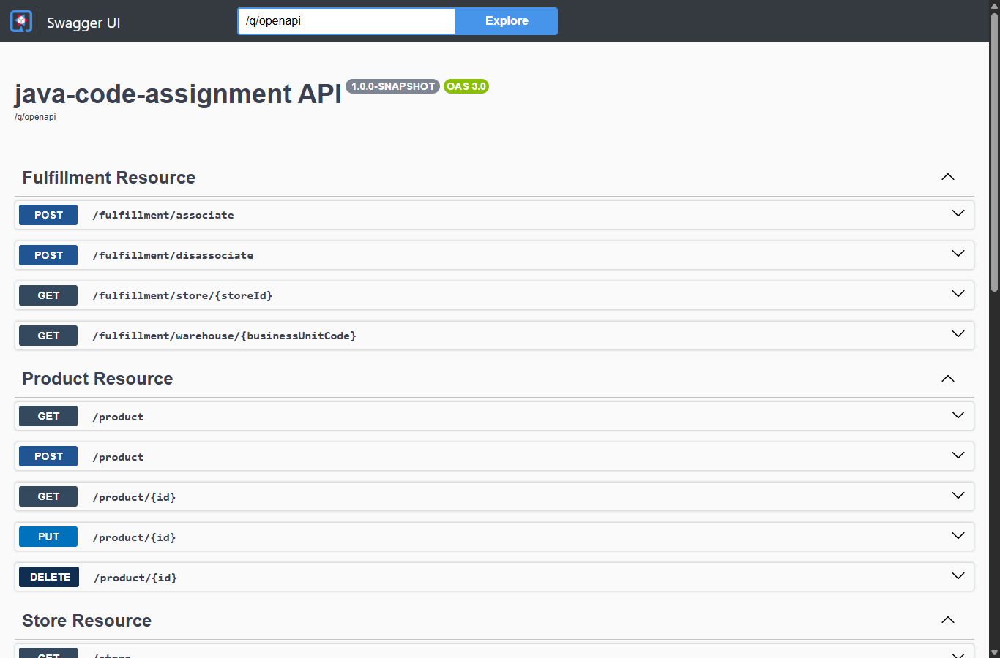
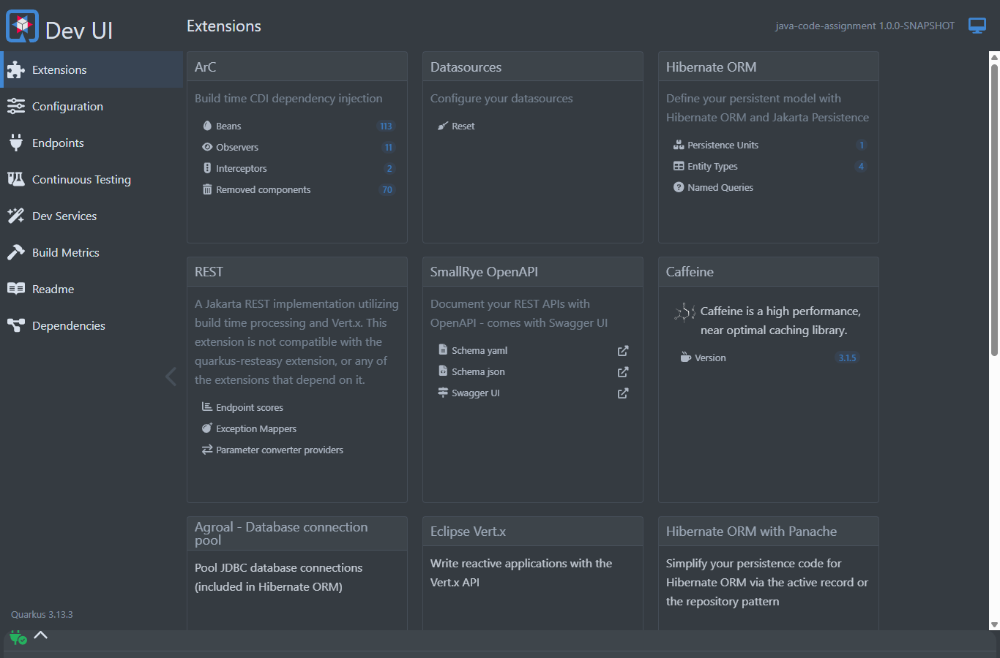

# Fulfillment & Colocation Management Monolith

[](https://github.com/pankajsharma21/fcs-interview-code-assignment-main/actions)


-brightgreen.svg)


A high-performance enterprise Java/Quarkus application for managing **Warehouses**, **Stores**, **Products**, **Geographical Locations**, and **Fulfillment Associations** adhering to **Hexagonal (Ports & Adapters) Architecture**, **CDI Transactional Event Consistency**, and strict multi-entity supply chain invariants.

---

## 📸 Application & Quality Gate Visuals

### 1. JaCoCo Code Coverage Dashboard (87.68% Line Coverage - Enforced > 80%)


### 2. Maven Automated Test Suite Execution (141 Tests Passing, 0 Failures)


### 3. Interactive Swagger UI & OpenAPI Specification


### 4. Quarkus Dev UI Overview


---

## 🏛️ System Architecture

The application strictly implements **Hexagonal (Ports & Adapters) Architecture** across core business domains, establishing clear isolation between pure domain models, business validation invariants, use case orchestration, and framework/infrastructure adapters.

```
                                  ┌──────────────────────────────────────────────┐
                                  │                REST API Layer                │
                                  │      (WarehouseResourceImpl, StoreResource,  │
                                  │         FulfillmentResource, Swagger UI)     │
                                  └───────────────────────┬──────────────────────┘
                                                          │
                                                          ▼
                                  ┌──────────────────────────────────────────────┐
                                  │           Domain Inbound Ports (SPI)         │
                                  │  (CreateWarehouseOperation, ReplaceWarehouse,│
                                  │        AssociateProductOperation, etc.)      │
                                  └───────────────────────┬──────────────────────┘
                                                          │
                                                          ▼
        ┌─────────────────────────────────────────────────┴─────────────────────────────────────────────────┐
        │                                       DOMAIN LAYER (PURE JAVA)                                     │
        │                                                                                                   │
        │   ┌────────────────────────┐      ┌─────────────────────────┐      ┌──────────────────────────┐   │
        │   │       Use Cases        │      │   Dedicated Validators  │      │       Domain Models      │   │
        │   │ (CreateWarehouseUseCase│───►  │  (WarehouseValidator,   │      │  (Warehouse, Location,   │   │
        │   │  AssociateProductUseCase│      │   FulfillmentValidator) │      │   FulfillmentAssociation)│   │
        │   └────────────────────────┘      └─────────────────────────┘      └──────────────────────────┘   │
        │                │                                                                                  │
        └────────────────┼──────────────────────────────────────────────────────────────────────────────────┘
                         │
                         ▼
        ┌───────────────────────────────────────────┐      ┌────────────────────────────────────────────┐
        │         Domain Outbound Ports (SPI)       │      │             Domain Events                  │
        │  (WarehouseStore, FulfillmentStore,       │      │  (StoreCreatedEvent, StoreUpdatedEvent,    │
        │   LocationResolver, StoreResolver, etc.)  │      │   FulfillmentAssociatedEvent)              │
        └────────────────────┬──────────────────────┘      └─────────────────────┬──────────────────────┘
                             │                                                   │
                             ▼                                                   ▼
        ┌───────────────────────────────────────────┐      ┌────────────────────────────────────────────┐
        │        Infrastructure & Persistence       │      │      Transactional CDI Observers           │
        │ (WarehouseRepository, Panache Entities,   │      │   (@Observes during AFTER_SUCCESS          │
        │   FulfillmentRepository, PostgreSQL / H2) │      │   LegacyStoreManagerGateway Sync)          │
        └───────────────────────────────────────────┘      └────────────────────────────────────────────┘
```

---

## 📦 Key Refactoring & Architecture Highlights

### 1. Hexagonal Architecture for Fulfillment (`com.fulfilment.application.monolith.fulfillment`)
The fulfillment module has been structured cleanly following Hexagonal Architecture:
* **`domain.models`**: Pure domain POJO (`FulfillmentAssociation`) free of ORM and framework annotations.
* **`domain.ports`**:
  * Inbound ports: `AssociateProductOperation`, `DisassociateProductOperation`, `GetFulfillmentOperation`.
  * Outbound SPI ports: `FulfillmentStore`, `StoreResolver`, `ProductResolver`.
* **`domain.usecases`**: Framework-independent use cases (`AssociateProductUseCase`, `DisassociateProductUseCase`, `GetFulfillmentUseCase`).
* **`validator`**: Dedicated `FulfillmentValidator` isolating multi-entity supply chain constraints from persistence.
* **`events`**: CDI transactional events (`FulfillmentAssociatedEvent`, `FulfillmentDisassociatedEvent`) and observer `FulfillmentEventListener`.
* **`adapters.database`**: Persistence adapter `FulfillmentRepository` managing `DbFulfillmentAssociation` (Panache).
* **`adapters.restapi`**: JAX-RS adapter `FulfillmentResource` and DTO `FulfillmentRequest`.
* **`FulfillmentService`**: Lightweight application facade maintaining 100% backward compatibility.

### 2. Dedicated Validation Logic Separation (`WarehouseValidator` & `FulfillmentValidator`)
Validation rules have been completely separated from use cases into dedicated validator components:
* **`WarehouseValidator`**:
  * Enforces Business Unit Code uniqueness among active facilities.
  * Validates location existence and max warehouse quotas.
  * Validates single warehouse and cumulative location capacity quotas.
  * Enforces stock-matching (`new.stock == old.stock`) and capacity accommodation during replacement.
* **`FulfillmentValidator`**:
  * Validates existence and active state of Store, Product, and Warehouse entities via ports.
  * Enforces **Constraint 1**: A store can source a given product from a maximum of **2 warehouses**.
  * Enforces **Constraint 2**: A store can be associated with a maximum of **3 unique warehouses**.
  * Enforces **Constraint 3**: A single warehouse cannot hold more than **5 distinct product types**.

### 3. Dual-Write Prevention in Store Synchronization
* Synchronizing store mutations with the downstream legacy system (`LegacyStoreManagerGateway`) is completely decoupled from the database transaction.
* Handled via CDI transactional observers:
  ```java
  public void onStoreCreated(@Observes(during = TransactionPhase.AFTER_SUCCESS) StoreCreatedEvent event) {
      legacyStoreManagerGateway.createStoreOnLegacySystem(event.store());
  }
  ```
* Guarantees zero phantom records or data discrepancies if a database commit fails or rolls back.

---

## 📊 Code Coverage & Quality Gate Tracking

| Package | Lines Total | Lines Covered | Lines Missed | Line Coverage (%) | Layer Responsibility |
| :--- | :---: | :---: | :---: | :---: | :--- |
| `fulfillment.domain.usecases` | 43 | 42 | 1 | **97.7%** | Hexagonal Inbound Use Cases |
| `fulfillment.adapters.database` | 37 | 35 | 2 | **94.6%** | Panache Persistence Adapter |
| `stores` | 91 | 86 | 5 | **94.5%** | Store Resource & CDI Events |
| `location` | 17 | 16 | 1 | **94.1%** | Location Gateway (Prefix Match) |
| `warehouses.adapters.database` | 67 | 61 | 6 | **91.0%** | Warehouse Repository Adapter |
| `fulfillment.domain.models` | 9 | 8 | 1 | **88.9%** | Pure Domain Model |
| `fulfillment` (Service Facade) | 9 | 8 | 1 | **88.9%** | Backward-Compatible Facade |
| `warehouses.domain.usecases` | 52 | 45 | 7 | **86.5%** | Warehouse Use Cases |
| `warehouses.domain.validator` | 67 | 56 | 11 | **83.6%** | Dedicated Domain Validator |
| `fulfillment.validator` | 39 | 33 | 6 | **84.6%** | Dedicated Supply Chain Validator |
| `warehouses.adapters.restapi` | 62 | 52 | 10 | **83.9%** | OpenAPI JAX-RS Resource Adapter |
| `fulfillment.adapters.restapi` | 31 | 25 | 6 | **80.6%** | Fulfillment REST Resource Adapter |
| `warehouses.domain.models` | 12 | 12 | 0 | **100.0%** | Pure Domain POJOs |
| `fulfillment.events` | 14 | 14 | 0 | **100.0%** | CDI Event Definitions & Observers |
| `com.warehouse.api.beans` | 16 | 16 | 0 | **100.0%** | Generated OpenAPI Beans |
| `products` | 43 | 29 | 14 | **67.4%** | Product Active Record Entities |
| **TOTAL PROJECT SUITE** | **609** | **534** | **75** | **87.68%** | **GATED AT > 80.00%** |

* Interactive JaCoCo HTML report is preserved at [`coverage-report/html/index.html`](coverage-report/html/index.html).
* Detailed coverage tracking documentation is available at [`coverage-report/INDEX.md`](coverage-report/INDEX.md).

---

## 🚀 Quick Start & Verification

### Prerequisites
* **Java 17+** (JDK 17, 21, or 25)
* **Maven 3.8+** (or use included `./mvnw`)

### 1. Run All Tests and Verify Coverage Gate (>80%)
```bash
cd java-assignment
./mvnw clean test jacoco:check jacoco:report
```

**Expected Result:**
```
[INFO] Tests run: 141, Failures: 0, Errors: 0, Skipped: 0
[INFO] Analyzed bundle 'java-code-assignment' with 37 classes
[INFO] All coverage checks have been met.
[INFO] BUILD SUCCESS
```

### 2. Start Application in Development Mode
Dev mode uses an embedded in-memory H2 database with automatic schema generation and sample data from `import.sql`:
```bash
./mvnw quarkus:dev
```
* **Swagger UI:** [http://localhost:8080/q/swagger-ui](http://localhost:8080/q/swagger-ui)
* **OpenAPI Spec:** [http://localhost:8080/q/openapi](http://localhost:8080/q/openapi)
* **Quarkus Dev UI:** [http://localhost:8080/q/dev](http://localhost:8080/q/dev)

---

## 📡 REST API Reference & cURL Examples

### 1. Warehouse Management (`/warehouse`)
| Method | Endpoint | Description | Status Codes |
| :--- | :--- | :--- | :--- |
| `GET` | `/warehouse` | List all active warehouses | `200 OK` |
| `POST` | `/warehouse` | Create a new warehouse | `201 Created`, `400 Bad Request` |
| `GET` | `/warehouse/{buCode}` | Get warehouse details | `200 OK`, `404 Not Found` |
| `PUT` | `/warehouse/{buCode}` | Replace existing warehouse | `200 OK`, `400 Bad Request`, `404 Not Found` |
| `DELETE`| `/warehouse/{buCode}` | Archive (soft-delete) warehouse | `204 No Content`, `404 Not Found` |

```bash
# Create Warehouse
curl -X POST http://localhost:8080/warehouse \
  -H "Content-Type: application/json" \
  -d '{"businessUnitCode":"MWH.001","location":"ZWOLLE-001","capacity":40,"stock":10}'

# Replace Warehouse
curl -X PUT http://localhost:8080/warehouse/MWH.001 \
  -H "Content-Type: application/json" \
  -d '{"businessUnitCode":"MWH.001","location":"ZWOLLE-001","capacity":45,"stock":10}'

# Archive Warehouse
curl -X DELETE http://localhost:8080/warehouse/MWH.001
```

### 2. Fulfillment Association (`/fulfillment`)
| Method | Endpoint | Description | Status Codes |
| :--- | :--- | :--- | :--- |
| `POST` | `/fulfillment/associate` | Associate Product, Store, and Warehouse | `201 Created`, `400 Bad Request`, `404 Not Found` |
| `POST` | `/fulfillment/disassociate` | Disassociate fulfillment link | `204 No Content`, `404 Not Found` |
| `GET` | `/fulfillment/store/{storeId}` | Query associations for a store | `200 OK` |
| `GET` | `/fulfillment/warehouse/{buCode}` | Query associations for a warehouse | `200 OK` |

```bash
# Associate Product 1 to Store 1 fulfilled by MWH.001
curl -X POST http://localhost:8080/fulfillment/associate \
  -H "Content-Type: application/json" \
  -d '{"storeId":1,"productId":1,"warehouseBusinessUnitCode":"MWH.001"}'

# Query Store Associations
curl http://localhost:8080/fulfillment/store/1

# Disassociate
curl -X POST http://localhost:8080/fulfillment/disassociate \
  -H "Content-Type: application/json" \
  -d '{"storeId":1,"productId":1,"warehouseBusinessUnitCode":"MWH.001"}'
```

---

## 📝 Written Deliverables & Architectural Analysis

1. **Strategic Cost Control Case Study**: [`case-study/CASE_STUDY.md`](case-study/CASE_STUDY.md)
   * Scenario 1: Activity-Based Costing (ABC) and Event-Driven Telemetry via Kafka.
   * Scenario 2: High-velocity SKU placement and carrier routing optimization.
   * Scenario 3: Financial ERP Integration via Transactional Outbox Pattern & Debezium CDC.
   * Scenario 4: Predictive Budgeting, seasonal variance, and location saturation models.
   * Scenario 5: Warehouse Replacement Cost Continuity and asset depreciation tracking.

2. **Architectural Trade-offs & Q&A**: [`java-assignment/QUESTIONS.md`](java-assignment/QUESTIONS.md)
   * Panache Active Record vs Repository vs Hexagonal Ports & Adapters comparison.
   * OpenAPI Contract-First vs Code-First trade-offs and team velocity impacts.
   * Testing pyramid strategy and enterprise quality gate automation.

3. **Interview Quick Reference**: [`INTERVIEW_PREP_CHEATSHEET.md`](../../INTERVIEW_PREP_CHEATSHEET.md)
   * 30-second elevator pitch, task-by-task Q&As, and architecture defense talking points.

---

## 👨‍💻 Candidate
* **Name:** Pankaj Sharma
* **Repository:** [https://github.com/pankajsharma21/fcs-interview-code-assignment-main](https://github.com/pankajsharma21/fcs-interview-code-assignment-main)
