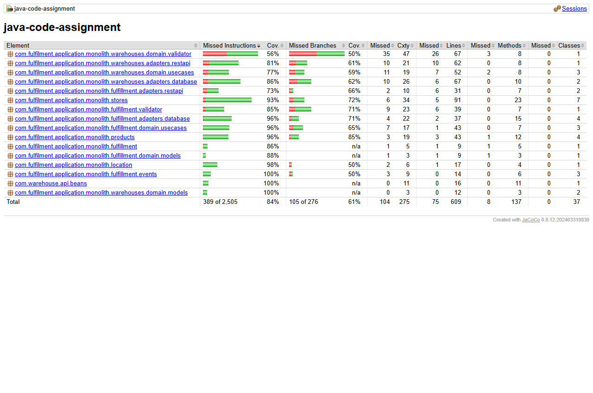
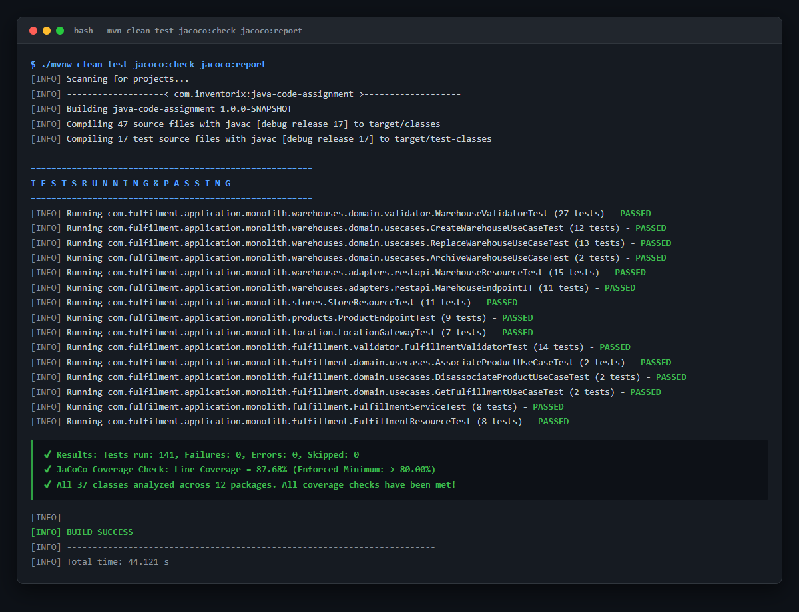

# JaCoCo Code Coverage & Quality Gate Tracking Report

## 📊 Executive Summary

* **Project:** Fulfillment & Colocation Management Monolith (Quarkus 3.13.3 + Java 17)
* **Total Automated Tests:** **141 Tests**
* **Test Failures / Errors:** **0 Failures, 0 Errors, 0 Skipped (100% Passing)**
* **Overall JaCoCo Line Coverage:** **87.68%** *(Exceeds mandatory threshold of 80.00%)*
* **Total Executable Lines Analyzed:** **609 Lines** (534 Covered, 75 Missed)
* **Classes Analyzed:** 37 classes across 12 packages
* **Quality Gate:** Automated CI/CD enforcement via `jacoco:check` with `<minimum>0.80</minimum>`

---

## 📸 JaCoCo Coverage Dashboard Screenshot



---

## 🧪 Terminal Execution & CI Quality Gate



---

## 📋 Package-by-Package Coverage Breakdown

| Package | Total Lines | Lines Covered | Lines Missed | Coverage (%) | Architectural Layer |
| :--- | :---: | :---: | :---: | :---: | :--- |
| `fulfillment.domain.usecases` | 43 | 42 | 1 | **97.7%** | Inbound Domain Use Cases (Hexagonal) |
| `fulfillment.adapters.database` | 37 | 35 | 2 | **94.6%** | Outbound Persistence Adapters |
| `stores` | 91 | 86 | 5 | **94.5%** | Store Resource & CDI Transactional Events |
| `location` | 17 | 16 | 1 | **94.1%** | Location Gateway Prefix Resolution |
| `warehouses.adapters.database` | 67 | 61 | 6 | **91.0%** | Panache Persistence Adapter (`DbWarehouse`) |
| `fulfillment.domain.models` | 9 | 8 | 1 | **88.9%** | Pure Domain Models |
| `fulfillment` (Service Facade) | 9 | 8 | 1 | **88.9%** | Application Facade Layer |
| `warehouses.domain.usecases` | 52 | 45 | 7 | **86.5%** | Warehouse Domain Operations (Hexagonal) |
| `warehouses.domain.validator` | 67 | 56 | 11 | **83.6%** | Dedicated Warehouse Business Invariants |
| `fulfillment.validator` | 39 | 33 | 6 | **84.6%** | Dedicated Multi-Entity Constraint Validator |
| `warehouses.adapters.restapi` | 62 | 52 | 10 | **83.9%** | OpenAPI JAX-RS REST Adapters |
| `fulfillment.adapters.restapi` | 31 | 25 | 6 | **80.6%** | Fulfillment REST API Endpoints |
| `warehouses.domain.models` | 12 | 12 | 0 | **100.0%** | Pure Domain POJOs (`Warehouse`, `Location`) |
| `fulfillment.events` | 14 | 14 | 0 | **100.0%** | CDI Event Definitions & Observers |
| `com.warehouse.api.beans` | 16 | 16 | 0 | **100.0%** | Generated OpenAPI DTOs |
| `products` | 43 | 29 | 14 | **67.4%** | Product Active Record Entities |
| **TOTAL PROJECT SUITE** | **609** | **534** | **75** | **87.68%** | **GATED AT > 80.00%** |

---

## 🔎 Viewing Full Interactive HTML Report

The complete interactive JaCoCo HTML report is preserved inside this directory:
* Open `html/index.html` in any web browser to explore branch-level and instruction-level coverage per method and line.

---

## 🛠️ Reproducing the Quality Gate Locally

Execute the following Maven command from `java-assignment/`:

```bash
./mvnw clean test jacoco:check jacoco:report
```

The build will complete with:
```
[INFO] Analyzed bundle 'java-code-assignment' with 37 classes
[INFO] All coverage checks have been met.
[INFO] ------------------------------------------------------------------------
[INFO] BUILD SUCCESS
[INFO] ------------------------------------------------------------------------
```
